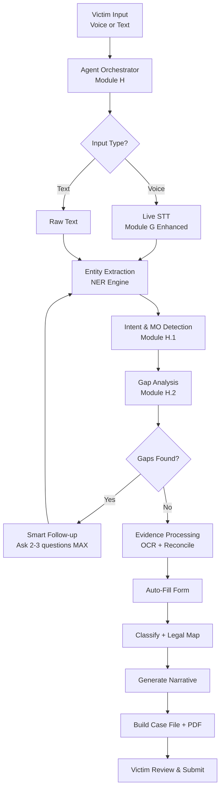
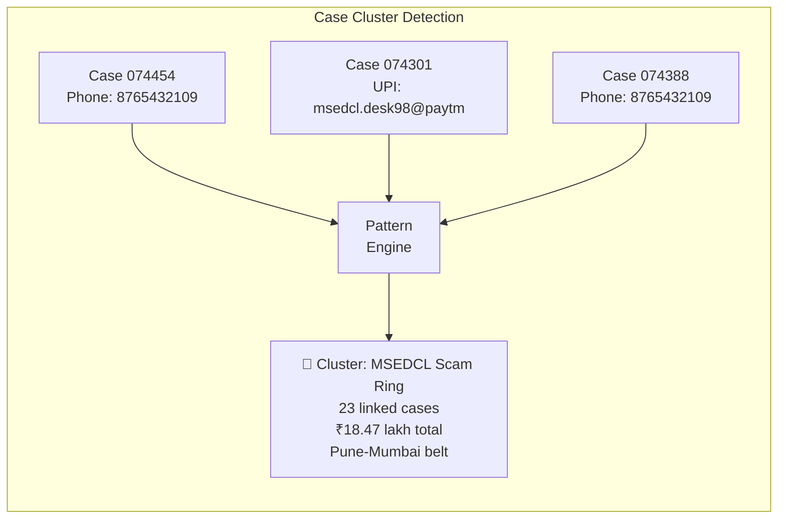
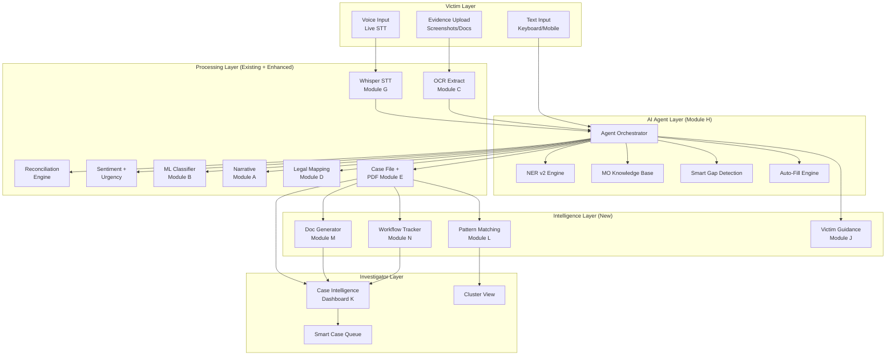

# NCRP Intelligent Grievance Portal — System Architecture v2.0

> **Vision**: A victim speaks or types once. The system does everything else — extracting, classifying, drafting, filing, and routing. An investigator opens a case and the system has already done 70% of the preliminary work.

---

## Part I: The Problem at Scale

### What Exists Today (Current System — v1.0)

Your project already has strong foundational modules:

| Module | File | What It Does |
|--------|------|-------------|
| Module A | [`ai_assistant.py`](file:///c:/Users/acer/OneDrive/Desktop/classifier_project/modules/ai_assistant.py) | Narrative standardisation (Hinglish → formal English) with zero-hallucination guards |
| Module B | [`pipeline.py`](file:///c:/Users/acer/OneDrive/Desktop/classifier_project/pipeline.py) | TF-IDF + LinearSVC classifier — 21 categories, 99.70% F1, 2.18ms |
| Module C | [`ocr_extract.py`](file:///c:/Users/acer/OneDrive/Desktop/classifier_project/modules/ocr_extract.py) | OCR entity extraction (UPI IDs, UTRs, amounts, phones) |
| Module D | [`legal_mapping.py`](file:///c:/Users/acer/OneDrive/Desktop/classifier_project/modules/legal_mapping.py) | Deterministic statutory mapping (BNS 2023, IT Act, POCSO) |
| Module E | [`case_file.py`](file:///c:/Users/acer/OneDrive/Desktop/classifier_project/modules/case_file.py) | Case file JSON + court-ready MHA PDF |
| Module F | [`dashboard.py`](file:///c:/Users/acer/OneDrive/Desktop/classifier_project/dashboard.py) | Streamlit UI portal |
| Module G | [`speech_to_text.py`](file:///c:/Users/acer/OneDrive/Desktop/classifier_project/modules/speech_to_text.py) | Whisper-based voice transcription |
| Gap Detection | [`gap_detection.py`](file:///c:/Users/acer/OneDrive/Desktop/classifier_project/modules/gap_detection.py) | Identifies missing fields, asks clarifying questions |
| Reconciliation | [`reconcile.py`](file:///c:/Users/acer/OneDrive/Desktop/classifier_project/modules/reconcile.py) | Cross-checks typed text vs. OCR evidence |
| Sentiment | [`sentiment_analysis.py`](file:///c:/Users/acer/OneDrive/Desktop/classifier_project/modules/sentiment_analysis.py) | Distress detection + Golden Hour urgency |

### What's Missing — The Gaps That Cost Time

| Gap | Impact on Victim | Impact on Investigator |
|-----|-----------------|----------------------|
| **No conversational agent** — victim still fills forms manually | 15-30 min filing time; victims abandon halfway | Officer gets incomplete complaints |
| **No intelligent entity pre-fill** — even after OCR extracts data, victim re-types it | Redundant effort; error-prone | Mismatched data between form and evidence |
| **No cross-case intelligence** — each case is isolated | Victim doesn't know their scam type or next steps | Officer can't see patterns across cases |
| **No modus operandi knowledge base** — system doesn't know how scams work | System can't anticipate what questions to ask | Officer manually identifies MO every time |
| **No investigation assistance** — officer does everything manually | Victim waits longer for resolution | 80% of officer time is clerical, not investigative |
| **No money trail graph** — financial transactions are flat text | Victim can't prove the chain | Officer traces manually across banks |
| **No suspect dedup** — same scammer across cases isn't linked | Victim is alone | Officer doesn't know this fraudster hit 50 others |

---

## Part II: The Complete v2.0 System — End-to-End Flow

### A. The Victim Side — "Just Speak, We Handle Everything"

```
┌──────────────────────────────────────────────────────────────────────────┐
│                    VICTIM'S JOURNEY (60 seconds)                        │
├──────────────────────────────────────────────────────────────────────────┤
│                                                                          │
│  ① SPEAK / TYPE (one-shot input)                                        │
│     "Main ek teacher hoon, mujhe WhatsApp pe ek link aaya               │
│      electricity bill ke liye, uspe click kiya toh 45000                 │
│      kat gaye mere HDFC account se"                                      │
│                                                                          │
│  ② AI AGENT TAKES OVER ──────────────────────────────────────────┐      │
│     │                                                             │      │
│     ├─► [Live STT] Convert speech to text in real-time            │      │
│     ├─► [NER] Extract: ₹45,000 | HDFC | WhatsApp | link          │      │
│     ├─► [Intent] Detect: Financial fraud → UPI/Net Banking        │      │
│     ├─► [MO Match] Match: Phishing link → APK/Malware fraud      │      │
│     ├─► [Gap Agent] Missing: date? UTR? account number?           │      │
│     │                                                             │      │
│     ├─► SMART FOLLOW-UP (only what's missing):                    │      │
│     │   "Yeh kab hua? Koi transaction reference number hai?"      │      │
│     │                                                             │      │
│     ├─► [OCR] User uploads screenshot → extract all entities      │      │
│     ├─► [Reconcile] Cross-check voice vs. screenshot              │      │
│     ├─► [Auto-Fill] Pre-populate entire complaint form            │      │
│     ├─► [Classify] Predict sub-category (2ms)                     │      │
│     ├─► [Legal Map] Attach BNS + IT Act sections                  │      │
│     ├─► [Narrative] Generate court-ready standardised text        │      │
│     ├─► [Urgency] Flag Golden Hour if <24h                        │      │
│     └─► [Case File] Generate PDF + JSON                           │      │
│         ────────────────────────────────────────────────────────┘      │
│                                                                          │
│  ③ VICTIM REVIEWS (10 seconds)                                          │
│     Pre-filled complaint shown → confirm or correct → SUBMIT            │
│                                                                          │
│  ④ INSTANT OUTPUT                                                       │
│     ├─ NCRP reference number                                            │
│     ├─ PDF acknowledgement download                                      │
│     ├─ "What to do next" guidance (freeze UPI, call 1930, etc.)         │
│     └─ Status tracking link                                              │
│                                                                          │
└──────────────────────────────────────────────────────────────────────────┘
```

---

## Part III: New Modules & Enhancements Required

### Module H — Conversational AI Agent (The Orchestrator)

> **Purpose**: A single agentic controller that takes raw voice/text, runs every module autonomously, asks only what's missing, and produces a complete complaint.



**What Module H Does Differently from Current Gap Detection:**

| Current System | Module H (New) |
|---------------|----------------|
| Gap detection runs AFTER victim fills forms | Agent runs BEFORE — victim never sees a blank form |
| Asks generic questions per category | Asks context-aware questions based on what was ALREADY extracted |
| No memory across the conversation | Maintains conversation state — never re-asks |
| Sequential processing | Parallel entity extraction + classification + legal lookup |
| Victim types complaint, then fills 8 form fields | Victim speaks once; agent fills all 8 fields from the speech |

**Technical Implementation:**

```
Agent State Machine:
  LISTENING → EXTRACTING → GAP_CHECKING → FOLLOW_UP → PROCESSING → REVIEW → DONE

Each state transition is autonomous. The agent moves forward 
without human intervention unless it genuinely needs information 
that cannot be inferred from any source.
```

**Key Design Rules:**
1. **Maximum 3 follow-up questions** — research shows victims abandon after 3
2. **Questions in the victim's detected language** (Hindi, Marathi, English, Hinglish)
3. **Never ask for something extractable from evidence** — if screenshot has the date, don't ask for it
4. **Progressive disclosure** — show what the system already knows, ask only for gaps
5. **Every question explains WHY** — "Aapka transaction number chahiye taaki bank ko turant freeze karne ka order diya jaa sake" (Your transaction number is needed so the bank can immediately freeze the account)

---

### Module H.1 — Modus Operandi Knowledge Base & Intent Detection

> **Purpose**: The system should KNOW how scams work in India. When a victim says "electricity bill ka message aaya", the system should immediately understand the entire attack pattern.

**Modus Operandi Database (MO-KB):**

```json
{
  "MO_ID": "MO-FIN-UPI-001",
  "name": "Fake Utility Bill Payment Scam",
  "aliases": ["bijli bill scam", "electricity bill fraud", "MSEDCL scam"],
  "attack_chain": [
    "Victim receives WhatsApp/SMS claiming utility bill overdue",
    "Message contains phishing link or APK download",
    "Link redirects to fake payment gateway OR APK installs screen-mirroring",
    "Victim enters UPI PIN / bank credentials",
    "Money debited via UPI or net banking"
  ],
  "typical_entities": ["amount", "upi_id", "whatsapp_number", "date", "bank_name"],
  "critical_for_investigation": ["UTR/transaction_ref", "beneficiary_upi_id", "screenshot_of_message"],
  "golden_hour_applicable": true,
  "typical_amount_range": [2000, 100000],
  "common_platforms": ["WhatsApp", "SMS"],
  "linked_categories": ["UPI Related Frauds", "Internet Banking Related Fraud"],
  "victim_guidance": {
    "immediate_actions": [
      "Call 1930 immediately for fund freeze",
      "Report to your bank's fraud helpline",
      "Do NOT delete the WhatsApp message/SMS — it is evidence",
      "Take screenshots of the message with sender's number visible"
    ],
    "evidence_to_preserve": [
      "WhatsApp chat screenshot with timestamp",
      "Bank statement showing debit",
      "UPI transaction confirmation screen",
      "SMS/call log from the scammer's number"
    ]
  }
}
```

**How MO-KB Reduces Time:**
1. When victim says "electricity bill ka message aaya" → System instantly matches `MO-FIN-UPI-001`
2. System already KNOWS what entities to extract (amount, UPI ID, date, bank)
3. System already KNOWS what questions to ask (UTR? sender's number?)
4. System can immediately tell victim "DON'T delete that WhatsApp message"
5. System pre-fills the modus operandi field in the case file

**Indian MO Database — Initial Categories:**

| MO Category | Sub-Types | Estimated Volume |
|------------|-----------|-----------------|
| **Fake Utility Bills** | Electricity, Water, Gas, Insurance | High |
| **UPI Collect/QR Fraud** | Fake QR, Collect request scam, Cashback lure | Very High |
| **Job Fraud** | Data entry job, Work-from-home, Task-based | High |
| **Loan App Harassment** | Predatory lending, Contact harassment, Morphed photos | Very High |
| **KYC/Bank Verification** | Fake KYC update, SIM swap, OTP fraud | High |
| **Investment/Trading** | Crypto, Stock trading, Task-based investment | High |
| **Sextortion/Blackmail** | Video call trap, Morphed images, Dating app | High |
| **Courier/Customs Fraud** | Fake customs call, Parcel drugs threat, FedEx scam | Medium |
| **Tech Support Fraud** | Remote access (AnyDesk/TeamViewer), Fake antivirus | Medium |
| **Social Media** | Account hacking, Impersonation, Fake profile | High |
| **E-Commerce** | Fake products, Non-delivery, Refund fraud | High |
| **Matrimonial** | Honey trap, Fake profile, Dowry demand | Medium |
| **Aadhaar/Identity** | Identity theft, Fake Aadhaar, Biometric fraud | Medium |
| **AePS Biometric** | Cloned fingerprint, Fake CSP, Rural POS fraud | Medium |

> [!IMPORTANT]
> This MO-KB is not ML — it's a curated, deterministic knowledge base built from real NCRP/I4C data patterns. It powers the agent's anticipation, not its classification.

---

### Module H.2 — Intelligent Entity Extraction (NER v2)

> **Purpose**: Go beyond regex-based OCR extraction. Use NLP-based Named Entity Recognition to pull structured data from unstructured voice/text in any Indian language.

**What Current OCR Extracts (Module C):**
- Amounts, UPI IDs, UTRs, phone numbers, dates, platforms (from screenshots only)

**What NER v2 Extracts (from voice/text + screenshots combined):**

| Entity Type | Example from Victim Speech | How It Helps |
|------------|---------------------------|-------------|
| `AMOUNT` | "paaintees hazaar" (35,000) | Auto-fills transaction amount |
| `BANK_NAME` | "SBI", "HDFC", "mere Punjab National Bank" | Auto-fills victim bank field |
| `DATE_RELATIVE` | "kal", "parso", "pichle week", "aaj subah" | Converts to absolute date for Golden Hour |
| `PHONE_NUMBER` | "9876543210 se call aaya" | Auto-fills suspect phone |
| `UPI_ID` | "fraud99@ybl pe bheja" | Auto-fills suspect UPI |
| `PLATFORM` | "WhatsApp", "Instagram", "olx pe ad tha" | Auto-fills platform involved |
| `PERSON_NAME` | "Rahul Sharma naam bataya tha" | Auto-fills suspect name |
| `LOCATION` | "Pune se call aaya", "Mumbai ka number tha" | Helps jurisdiction routing |
| `PROFESSION` | "main teacher hoon", "mera beta student hai" | Context for officer |
| `RELATIONSHIP` | "mere papa ke account se" | Identifies actual victim |
| `EMOTIONAL_STATE` | "bahut darr laga", "raat bhar neend nahi aayi" | Feeds sentiment/urgency engine |

**Technical Approach:**
- **For Hindi/Hinglish/Marathi**: Fine-tuned multilingual BERT (ai4bharat/IndicNER) or use Ollama with structured output
- **For English**: spaCy + custom patterns
- **Hybrid**: Regex for structured data (UTR, UPI) + NER for contextual data (names, dates, locations)
- **All local/offline** — no cloud dependency

---

### Module I — Auto-Fill Engine

> **Purpose**: Takes all extracted entities (from NER + OCR + conversation) and pre-populates every field in the complaint form. The victim sees a COMPLETE form and only needs to verify.

**Current Flow (victim does 90% work):**
```
Victim types complaint → Victim fills suspect details → Victim fills bank details 
→ Victim fills personal details → Victim fills transaction table → Submit
```

**New Flow (system does 90% work):**
```
Victim speaks/types complaint → 
  System extracts ALL entities →
  System fills ALL form fields →
  System asks 2-3 clarifying questions for missing CRITICAL fields →
  Victim gets a pre-filled form → Reviews → Corrects if needed → Submit
```

**Auto-Fill Mapping:**

| Form Section | Fields | Source Priority |
|-------------|--------|---------------|
| **Complainant** | Name, Age, Phone, Email, City, State, PIN, Police Station | User profile (if logged in) → NER from voice → Manual |
| **Incident** | Date/Time, Platform, Category, Sub-Category, Modus Operandi | NER (relative dates) → OCR (timestamps) → MO-KB → Classifier |
| **Suspect** | Name, Phone, UPI ID, Email, Social Media Handle | NER from voice → OCR from screenshots |
| **Transactions** | Amount, Bank, A/c No., UTR, Date, Beneficiary | OCR (highest priority) → NER from voice → Manual only if critical |
| **Evidence** | Screenshots, Chat logs, Transaction receipts | OCR auto-processes all uploaded files |

> [!TIP]
> **Estimated Time Reduction**: From 15-30 minutes → **60-90 seconds** for a typical financial fraud complaint.

---

### Module J — Victim Guidance Engine

> **Purpose**: After filing, immediately tell the victim what to do next. Most victims have no idea about 1930, Golden Hour, or how to preserve evidence.

**What It Generates (personalized per case type):**

```
╔══════════════════════════════════════════════════════════════╗
║  🚨 IMMEDIATE ACTIONS FOR YOUR CASE                        ║
║                                                              ║
║  Your case has been classified as: UPI Related Fraud         ║
║  Golden Hour Status: ✅ ACTIVE (reported within 4 hours)     ║
║                                                              ║
║  DO THIS NOW:                                                ║
║  ① Call 1930 (National Cyber Crime Helpline) — quote your    ║
║    NCRP reference: NCRP/2026/074454                          ║
║  ② Call HDFC Bank fraud helpline: 1800-XXX-XXXX              ║
║    Request immediate lien on UTR: 326712345678               ║
║  ③ DO NOT delete any WhatsApp messages or SMS from the       ║
║    scammer — they are legal evidence under BSA 2023 §63      ║
║  ④ File a written complaint at your nearest police station   ║
║    with this PDF acknowledgement                              ║
║                                                              ║
║  EVIDENCE TO PRESERVE:                                       ║
║  • Screenshot of the phishing message (already uploaded ✓)   ║
║  • Bank statement for last 30 days (download from net banking)║
║  • Call log showing scammer's number                          ║
║                                                              ║
║  EXPECTED TIMELINE:                                          ║
║  • Bank fund freeze: 24-72 hours                             ║
║  • Police acknowledgement: 3-7 days                          ║
║  • Investigation updates: Check status using your NCRP ID    ║
╚══════════════════════════════════════════════════════════════╝
```

**Bank Helpline Database (built-in):**

| Bank | Fraud Helpline | Card Block | Email |
|------|---------------|------------|-------|
| SBI | 1800-11-1109 | 1800-425-3800 | phishing@sbi.co.in |
| HDFC | 1800-266-4332 | 1800-103-7766 | - |
| ICICI | 1800-200-3344 | - | - |
| Axis | 1800-419-5959 | - | - |
| PNB | 1800-180-2222 | - | - |
| Kotak | 1800-266-0811 | - | - |
| BOB | 1800-102-4455 | - | - |
| *All Banks* | *1930* | - | - |

---

## Part IV: The Investigator Side — "I Want to Understand Their Investigation, Then Assist"

### The Core Philosophy

> [!IMPORTANT]
> **We do NOT replace the investigator. We do NOT decide. We prepare, organize, surface, and suggest.** The officer makes every decision. Our job is to ensure the officer never wastes time on clerical work.

### What an Investigator Actually Does (Current Process)

```
1. Receive complaint → Read it → Understand what happened
2. Verify complainant identity (Aadhaar, phone OTP)  
3. Identify the crime type and applicable sections
4. Identify suspects (phone, UPI, IP, social media)
5. Request bank records (send letters to banks for statements)
6. Trace money trail (follow the money across accounts)
7. Correlate with other complaints (is this the same scammer?)
8. Collect digital evidence (CDR, IP logs, social media records)
9. Prepare charge sheet with all evidence and sections
10. Present to court
```

### What the System Can Automate (Steps the AI Handles)

| Step | Current (Manual) | v2.0 (AI-Assisted) | Time Saved |
|------|-----------------|--------------------|-----------| 
| Read & understand complaint | 10-15 min per case | **Executive Summary** — 3-line synopsis with key facts, victim profile, MO match | 90% |
| Identify crime type & sections | 5-10 min (manual lookup) | **Already done at intake** — classifier + legal mapping | 100% |
| Identify suspects | 20-30 min (read through evidence) | **Suspect Profile Card** — all entities extracted and correlated | 80% |
| Cross-reference cases | Impossible manually at scale | **Pattern Matching Engine** — auto-links cases with same phone/UPI/MO | 100% (new capability) |
| Money trail visualization | Hours (manual bank statements) | **Financial Graph** — visual transaction chain from victim → mule accounts | 70% |
| Draft bank notices | 30 min per notice | **Auto-generated** — template + case-specific data filled in | 90% |
| Prepare charge sheet | 2-4 hours | **Pre-drafted** — with evidence table, sections, and narrative | 60% |

---

### Module K — Investigator AI Dashboard (Case Intelligence)

> **Purpose**: When an officer opens a case, everything they need is already prepared, analyzed, and presented.

**Case Intelligence View:**

```
┌─────────────────────────────────────────────────────────────────────┐
│ CASE: NCRP/2026/074454                                              │
│ Status: GOLDEN HOUR ACTIVE | Priority: CRITICAL | Age: 4 hours      │
├─────────────────────────────────────────────────────────────────────┤
│                                                                     │
│ 📋 EXECUTIVE SUMMARY (3 lines)                                     │
│ Victim (Rajesh Sharma, M/34, Pune) lost ₹45,000 via UPI on         │
│ 22-Sep-2026 after clicking a phishing link impersonating MSEDCL     │
│ electricity department sent via WhatsApp. Golden Hour active.        │
│                                                                     │
│ 🎯 MODUS OPERANDI MATCH                                            │
│ MO-FIN-UPI-001: Fake Utility Bill Payment Scam                     │
│ Confidence: 94.2% | Similar cases in last 30 days: 147             │
│                                                                     │
│ 🔍 SUSPECT PROFILE                                                 │
│ ┌──────────────────────────────────────────────────────────────┐    │
│ │ Phone: 8765432109 (used in 12 other complaints)              │    │
│ │ UPI: msedcl.desk98@paytm (used in 23 other complaints)      │    │
│ │ Active Period: 15 Sep - 22 Sep 2026                          │    │
│ │ Total Amount Defrauded (linked cases): ₹18,47,000            │    │
│ │ Victim Geography: Pune (8), Mumbai (3), Nashik (1)           │    │
│ └──────────────────────────────────────────────────────────────┘    │
│                                                                     │
│ 💰 FINANCIAL TRAIL                                                  │
│ Victim A/c (HDFC XX1234) ──₹45,000──→ msedcl.desk98@paytm         │
│                                          │                          │
│                                    [Requires bank data to extend]   │
│                                                                     │
│ ⚖️ APPLICABLE SECTIONS (Pre-Mapped)                                │
│ BNS §318(4) | IT Act §66D | BSA §63 notice attached                │
│                                                                     │
│ 📎 EVIDENCE INVENTORY                                               │
│ ✅ WhatsApp screenshot (OCR verified: amount matches)               │
│ ✅ Victim statement (standardised + verbatim)                       │
│ ❌ Bank statement (not yet obtained)                                │
│ ❌ CDR for suspect number (not yet requested)                       │
│                                                                     │
│ 🔗 LINKED CASES (Same Suspect Network)                              │
│ NCRP/2026/074301 | NCRP/2026/074388 | NCRP/2026/074412 | +9 more  │
│                                                                     │
│ 📝 SUGGESTED NEXT ACTIONS                                           │
│ ① Send fund freeze request to Paytm Payments Bank (template ready) │
│ ② Request CDR from telecom for 8765432109 (template ready)         │
│ ③ Check if suspect UPI is already flagged by I4C/RBI                │
│ ④ Merge with 12 linked cases for combined investigation             │
│                                                                     │
└─────────────────────────────────────────────────────────────────────┘
```

---

### Module L — Cross-Case Pattern Intelligence

> **Purpose**: Connect cases that share the same suspect phone, UPI ID, bank account, IP address, or MO pattern. A single fraudster running a campaign leaves digital fingerprints across dozens of complaints.

**How It Works:**



**Linkage Signals (ranked by strength):**

| Signal | Strength | Example |
|--------|----------|---------|
| Same UPI ID | 🔴 Very Strong | `msedcl.desk98@paytm` across 23 complaints |
| Same phone number | 🔴 Very Strong | `8765432109` across 12 complaints |
| Same bank account | 🔴 Very Strong | Beneficiary A/c XX4567 in 8 complaints |
| Same MO + geography + time window | 🟡 Strong | Fake MSEDCL, Pune, Sept 2026 |
| Same WhatsApp message text (fuzzy match) | 🟡 Strong | Identical phishing template |
| Same IP/domain in phishing link | 🔴 Very Strong | `msedcl-pay.xyz` in URL |
| Amount patterns | 🟢 Moderate | Same ₹5,000 or ₹10,000 pattern |

**Output for Investigator:**
- **Cluster Report**: "23 complaints linked to this suspect network. Total defrauded: ₹18.47 lakh. Active Sept 15-22."
- **Combined Suspect Dossier**: All known identifiers (phones, UPIs, accounts, IPs) for the scam ring
- **Geographic Heat Map**: Where victims are concentrated
- **Timeline**: When the campaign started, peaks, and if it's still active
- **Combined Evidence Inventory**: Strongest evidence pieces across ALL linked cases

---

### Module M — Investigation Document Generator

> **Purpose**: Auto-generate the notice letters, requests, and templates that officers spend hours writing manually.

**Templates Auto-Generated:**

| Document | What It Does | Time Saved |
|----------|-------------|-----------|
| **Bank Fund Freeze Request** | Letter to destination bank with UTR, amount, time — requesting lien under RBI Circular | 30 min → instant |
| **CDR Request** | Letter to telecom requesting Call Detail Records for suspect number | 20 min → instant |
| **IP Log Request** | Letter to ISP/platform requesting IP logs for suspect account | 20 min → instant |
| **Social Media Preservation** | Letter to WhatsApp/Instagram/Meta requesting account data preservation | 20 min → instant |
| **Section 91 BNSS Notice** | Formal court notice for production of electronic records | 30 min → instant |
| **Charge Sheet Draft** | Pre-filled charge sheet with evidence table, sections, suspect details | 2-4 hours → 30 min review |
| **Victim Status Update** | Standardised status letter to victim at each investigation stage | 10 min → instant |

**How It Works:**
- Templates are parameterized with case-specific data
- All data comes from the case file (already extracted by Modules C, H, K)
- Officer reviews, modifies if needed, and sends
- Each generated document is logged in the case file's evidence chain

---

### Module N — Investigation Workflow Tracker

> **Purpose**: Track where each case is in the investigation lifecycle and what's blocking progress.

**Investigation Stages:**

```
INTAKE → VERIFICATION → BANK_ACTION → EVIDENCE_COLLECTION → 
SUSPECT_IDENTIFICATION → ARREST_WARRANT → CHARGE_SHEET → COURT
```

**What the System Tracks:**

| Check | Status | Auto-Detection |
|-------|--------|---------------|
| Fund freeze requested? | ✅/❌ | Tracks if bank letter was generated |
| Bank responded? | ✅/❌ | Officer updates; system reminds if overdue |
| CDR obtained? | ✅/❌ | Tracks if CDR request was sent |
| Suspect identified by name? | ✅/❌ | Checks if case has suspect name |
| Linked cases merged? | ✅/❌ | Auto-suggests if cluster exists |
| Charge sheet prepared? | ✅/❌ | Tracks document generation |
| Evidence certificate (BSA §63)? | ✅/❌ | Auto-generates and attaches |

**Automated Nudges to Officer:**
- "Fund freeze request was sent 48 hours ago. Bank has not responded. Escalation template ready."
- "CDR for suspect number 8765432109 has arrived. 3 new linked cases found."
- "This case has been in EVIDENCE_COLLECTION for 15 days. 2 evidence items still pending."

---

## Part V: Technical Architecture

### System Components Overview



### Technology Stack

| Component | Technology | Why |
|-----------|-----------|-----|
| **Live Speech-to-Text** | Whisper (local) + WebSocket streaming | Offline, 16 languages, no cloud dependency |
| **NER (Hindi/Hinglish)** | ai4bharat/IndicNER OR Ollama structured output | Best Indian language NER; local inference |
| **Agent Orchestrator** | Python state machine (no LangChain overhead) | Deterministic, auditable, no unnecessary abstractions |
| **MO Knowledge Base** | JSON knowledge base (curated) | Deterministic, expert-curated, versioned |
| **Pattern Matching** | SQLite FTS5 + Python graph (NetworkX) | Lightweight, local, no database server needed |
| **ML Classifier** | TF-IDF + LinearSVC (existing) | 99.70% F1, 2ms, 18.5MB RAM — already excellent |
| **Document Generation** | ReportLab (existing) + Jinja2 templates | Professional PDFs, parameterized templates |
| **LLM (narrative only)** | Ollama (local Qwen2.5:7b) | Already integrated; zero-hallucination guards |
| **UI** | Streamlit (existing) | Rapid iteration, already deployed |
| **Storage** | JSON files + SQLite | No server infrastructure, works offline |

### What We Do NOT Need

| Technology | Why NOT |
|-----------|---------|
| LangChain/LlamaIndex | Unnecessary abstraction; our pipeline is deterministic and simple |
| Cloud LLMs (GPT-4, Claude) | Air-gapped requirement; citizen data must stay local |
| Vector databases (Pinecone, Chroma) | No semantic search needed; pattern matching is exact-entity |
| Kubernetes/Docker | Police station deployment = single machine |
| MongoDB/PostgreSQL | SQLite handles everything; no DBA needed at stations |

---

## Part VI: Implementation Priority & Roadmap

### Phase 1 — Agent Core (Biggest Impact, Fastest)

> **Impact**: Reduces victim filing time from 15-30 min → 60-90 seconds

| Task | Module | Effort | Priority |
|------|--------|--------|----------|
| Build Agent Orchestrator state machine | H | 3-4 days | 🔴 Critical |
| Build MO Knowledge Base (top 14 scam types) | H.1 | 2-3 days | 🔴 Critical |
| Enhance NER to extract entities from voice/text | H.2 | 3-4 days | 🔴 Critical |
| Build Auto-Fill Engine | I | 2 days | 🔴 Critical |
| Build Victim Guidance Engine | J | 1-2 days | 🟡 High |
| Integrate live STT with WebSocket streaming | G+ | 2 days | 🟡 High |

### Phase 2 — Investigator Intelligence (Second Biggest Impact)

> **Impact**: Reduces investigation preliminary work by 60-70%

| Task | Module | Effort | Priority |
|------|--------|--------|----------|
| Build Case Intelligence Dashboard | K | 3-4 days | 🔴 Critical |
| Build Cross-Case Pattern Engine | L | 4-5 days | 🔴 Critical |
| Build Investigation Document Generator (6 templates) | M | 3 days | 🟡 High |
| Build Workflow Tracker | N | 2-3 days | 🟡 High |

### Phase 3 — Advanced Intelligence (Long-term)

| Task | Description | Effort |
|------|------------|--------|
| Scam campaign detection | Auto-detect new emerging scam patterns from intake volume spikes | 1 week |
| Predictive suspect location | Based on UPI merchant registration addresses, CDR tower locations | 1 week |
| Multi-jurisdiction routing | Auto-assign cases to correct cyber police station based on crime type + geography | 3-4 days |
| Victim notification system | SMS/WhatsApp status updates to victim at each investigation milestone | 2-3 days |
| Bulk case merge & combined charge sheet | Merge 50+ cases against same suspect into one investigation | 1 week |

---

## Part VII: The Competitive Edge — What Makes This Different

### vs. Current NCRP Portal (cybercrime.gov.in)

| Feature | Current Portal | This System |
|---------|---------------|-------------|
| Filing time | 20-45 minutes | **60-90 seconds** |
| Language support | English + Hindi forms | **16 languages via voice** |
| Form filling | Manual, 8 pages | **AI auto-fills from voice** |
| Evidence processing | Upload only, no analysis | **OCR + reconciliation + verification** |
| Legal sections | Manual lookup by officer | **Instant auto-mapping** |
| Cross-case linking | Completely manual | **Automatic pattern detection** |
| Investigation assistance | None | **Full AI-assisted workflow** |
| Victim guidance | Generic FAQ | **Personalized, actionable, immediate** |

### vs. Global Platforms (FBI IC3, UK Action Fraud, EU Cybercrime)

| Feature | Global Platforms | This System |
|---------|-----------------|-------------|
| Voice input | ❌ None | ✅ 16 Indian languages |
| Conversational filing | ❌ Form-based | ✅ Agentic AI guided |
| OCR evidence analysis | ❌ Manual | ✅ Automatic entity extraction |
| Legal section mapping | ❌ Not automated | ✅ BNS/IT Act/POCSO instant |
| Cross-case intelligence | Limited | ✅ Real-time pattern matching |
| Offline/air-gapped | ❌ Cloud-only | ✅ Fully local deployment |
| Investigation AI | ❌ None | ✅ Document generation, case linking |

---

> [!NOTE]
> This architecture is designed to be **incrementally implementable**. Each module is independent and adds value on its own. You don't need to build everything before seeing results — Module H (Agent) alone transforms the victim experience.

---

*Document prepared for NCRP Research & Technical Directorate — System Architecture v2.0*
